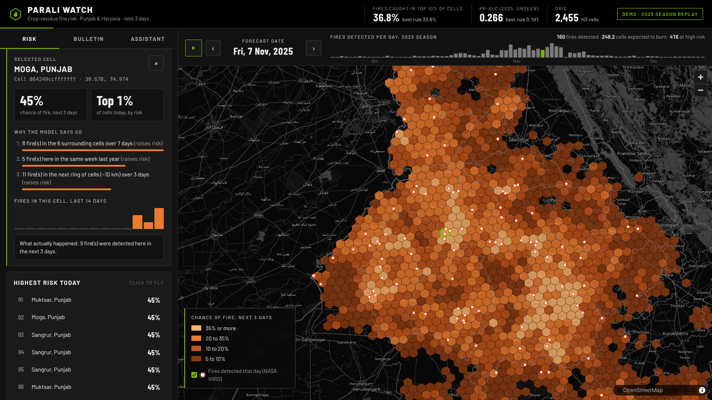

# paraliWatch

**Parali Watch forecasts where crop-residue (paddy straw) fires are likely in Punjab and Haryana
over the next 3 days, explains why, and shows it on a map**, so officials can send teams and
machines before the burning, not after. It also writes a daily bulletin for district officers in
English and Hindi, answers questions about the rules and schemes from official documents with page
citations, and exposes all of this as tools for AI assistants through an MCP server.



## Why

Every October and November, paddy-straw burning in Punjab and Haryana adds heavy smoke to north
India's air. Satellites count fires after they happen. Parali Watch turns those counts into a
forward-looking, explained risk map at ~36 km2 resolution.

## Results (unseen 2025 season)

| Method | PR-AUC | Fire capture @10% |
| --- | --- | --- |
| **Parali Watch (LightGBM)** | **0.266** | **36.8%** |
| Best simple rule (fires in and around the cell, last 3 days) | 0.191 | 33.6% |
| Random guess | 0.049 | 10.0% |

*Fire capture @10%: if officials watched only the 10% of cells ranked highest each day, the share
of the next 3 days' fires they would cover.* Full results: [`eval/RESULTS.md`](eval/RESULTS.md).
How the model was chosen (7 model families, bootstrap tests, ablation):
[`docs/MODEL_SELECTION.md`](docs/MODEL_SELECTION.md).

## What's inside

| Part | What it does | Details |
| --- | --- | --- |
| Forecast | LightGBM risk per ~36 km2 cell for the next 3 days, calibrated, with SHAP reasons | [Model selection](docs/MODEL_SELECTION.md) |
| Dashboard | Map, date slider, cell explanations, top-risk list | [Architecture](docs/ARCHITECTURE.md) |
| Bulletin agents | LangGraph monitor -> analyst -> writer; EN + HI; official approves | [Agents and MCP](docs/AGENTS_AND_MCP.md) |
| Assistant (RAG) | Hybrid search + multilingual reranker over CAQM, PIB, Haryana and ICAR documents; cited answers; refuses when unsure | [RAG](docs/RAG.md) |
| MCP server | 7 tools: risk, explanations, fires, district summary, bulletin, scheme search | [Agents and MCP](docs/AGENTS_AND_MCP.md) |
| Foundation-model check | Chronos-Bolt zero-shot vs the tuned model | [Model selection, section 10](docs/MODEL_SELECTION.md) |
| Burn-scar segmentation | Prithvi-EO-2.0 (NASA/IBM) fine-tuned vs U-Net on HLS Burn Scars: 0.758 vs 0.700 IoU; Punjab transfer tested honestly | [Burn scars](docs/BURN_SCARS.md) |
| Voice input | Speak a question (Hindi or English), Whisper small transcribes it (WER 0.57 on FLEURS Hindi), the answer is read aloud | [Voice](docs/VOICE.md) |
| Fine-tuned small LLM | LoRA on Qwen2.5-0.5B with synthetic, guardrail-verified data: cited answers 0/37 -> 19/37 (kept as an experiment) | [Fine-tuning](docs/FINE_TUNING.md) |

## Quick start

Needs Python 3.10+ and [uv](https://docs.astral.sh/uv/). The repository ships the trained model
and 2025 demo data, so the dashboard runs without downloading anything.

```bash
git clone https://github.com/sasmit-yadav/paraliWatch.git
cd paraliWatch
uv sync
uv run python -m parali serve
```

Open http://127.0.0.1:8000 (API docs at http://127.0.0.1:8000/docs). The first question to the
assistant downloads two small models (~800 MB, once) and builds the document index (~1 minute).

Optional: connect any OpenAI-compatible LLM for written answers (otherwise the assistant quotes
the documents):

```bash
# Ollama example
export PARALI_LLM_BASE_URL=http://localhost:11434/v1 PARALI_LLM_MODEL=qwen2.5:7b
# or a hosted API: PARALI_LLM_BASE_URL=<provider's /v1 URL> PARALI_LLM_API_KEY=<key> PARALI_LLM_MODEL=<model>
```

Other commands:

```bash
uv run python -m parali ask "Up to what percentage can power plants co-fire paddy straw pellets?"
uv run python -m parali bulletin 2025-11-07
uv run python -m parali mcp           # MCP server over stdio
uv run python -m parali add-url <link to an official page>   # then: uv run python -m parali index
```

Or with Docker: `docker compose up --build`.

### Phase 3 extras (optional)

```bash
uv sync --group voice            # mic button in the dashboard (Whisper speech-to-text)
uv sync --group vision           # burn-scar models: python -m parali.detect.train / compare / punjab
uv sync --group tune             # LoRA fine-tuning: python -m parali.tune.data / lora / serve
```

See [Burn scars](docs/BURN_SCARS.md), [Voice](docs/VOICE.md) and [Fine-tuning](docs/FINE_TUNING.md)
for data downloads and exact commands.

### Rebuild everything from the raw data

```bash
uv run python -m parali data    # downloads ~330 MB of FIRMS archives, boundaries, weather (~5 min)
uv run python -m parali train   # trains, evaluates, writes eval/ and data/demo/ (~2 min)
uv run pytest                   # 38 tests (Phase 3 model tests skip unless the optional groups are installed)
```

## How it works

1. **Data:** NASA FIRMS VIIRS fire points (2019-2025), Open-Meteo ERA5 weather, geoBoundaries
   districts. See [`docs/DATA.md`](docs/DATA.md).
2. **Grid:** 2,455 H3 hexagons (~36 km2) covering both states.
3. **Features:** 26 per cell per day: recent fires in the cell and around it, last year's fires on
   the same days, past-season history, day of season, weather. Only data available by that day.
4. **Model:** LightGBM, trained on 2020-2023, tuned and calibrated on 2024, tested once on 2025.
5. **Explanations:** the top 3 SHAP reasons per cell, written as plain sentences ("15 fires in the
   6 surrounding cells over 7 days").
6. **Dashboard:** FastAPI + MapLibre. Pick a day, see risk, click a cell for its reasons, its
   14-day history and what actually happened next.

Architecture: [`docs/ARCHITECTURE.md`](docs/ARCHITECTURE.md).

## Honest limitations

- It predicts **satellite-detected** fires. Detected daytime fires fell ~17x from 2021 to 2025 while
  night detections rose, so some burning may be happening when the satellite is not overhead.
- The 2025 test season was much quieter than the training seasons.
- Weather adds little today because only observed weather is used; forecast weather is planned.

## Roadmap

Done: phase 1 (data, forecast, model comparison, dashboard) and phase 2 (document assistant,
bulletin agents, MCP server, foundation-model comparison). Next: burn-scar detection from
satellite images, Hindi voice and a fine-tuned small model, then MLOps. See
[`docs/ROADMAP.md`](docs/ROADMAP.md) and the [development log](docs/DEVLOG.md).

## Data credits

NASA FIRMS (VIIRS S-NPP) · Open-Meteo / Copernicus ERA5 · geoBoundaries · OpenStreetMap
contributors (basemap) · Commission for Air Quality Management · Press Information Bureau ·
Agriculture Department Haryana · ICAR-IARI CREAMS.

## Licence

MIT. See [LICENSE](LICENSE).
