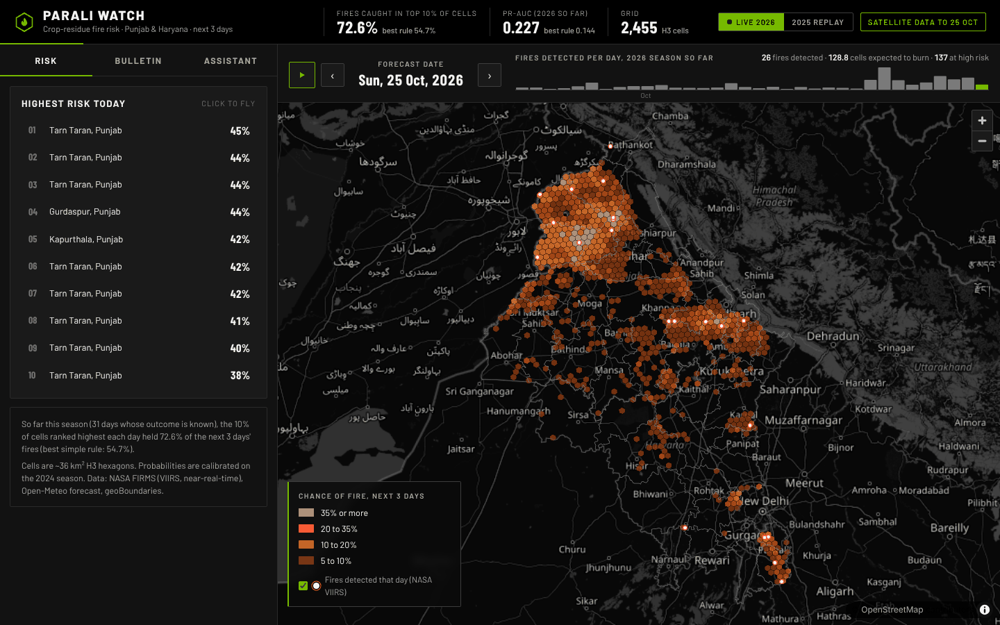

# Live mode: forecasting the season that is happening now

The model was trained on 2020-2023, tuned on 2024 and tested once on 2025. A test on a finished
season shows the model works on unseen data. It does not help anyone today. Live mode runs the
same saved model on **this season's satellite data**, refreshed every few hours, so the map shows
tomorrow's likely fires. The 2025 replay stays in the dashboard as the scored evidence.



Code: [`parali/live.py`](../parali/live.py) (build) and
[`parali/app/seasons.py`](../parali/app/seasons.py) (which season the API serves).

---

## 1. Turning it on

1. Get a free NASA FIRMS key at https://firms.modaps.eosdis.nasa.gov/api/map_key/ (it arrives by
   email in a minute).
2. Put it in `.env` at the repository root. Git ignores `.env`, so the key never gets committed:

   ```
   FIRMS_MAP_KEY=<your key>
   ```

3. Live mode builds on the archive of earlier seasons (features such as "fires in this cell on
   the same days last year"). If you have not already, run `uv run python -m parali data` once.
4. `uv run python -m parali serve`. The app builds the live season in the background (about 2
   minutes), then rebuilds it every 3 hours. To build it by hand: `uv run python -m parali live`.

Without a key nothing changes: the dashboard shows the 2025 replay as before.

| Setting (`.env`) | Default | Meaning |
| --- | --- | --- |
| `FIRMS_MAP_KEY` | empty | Turns live mode on |
| `PARALI_LIVE_REFRESH_HOURS` | 3 | Hours between background rebuilds |
| `PARALI_LIVE` | 1 | `0` switches the background rebuild off (the `live` command still works) |

---

## 2. What one rebuild does

```
NASA FIRMS (VIIRS S-NPP, near-real-time)      Open-Meteo forecast API
  fire points, 15 Sep -> today                  daily weather, 15 Sep -> today + 3 days
  in 5-day requests (the API's maximum)          (no key needed)
              \                                  /
               \                                /
     archive of earlier seasons (data/processed)  ->  build_panel(..., only=this season)
                                                        same feature code as training
                                                              |
                                        saved LightGBM model + isotonic calibrator
                                                              |
                                   probability, rank and top-3 SHAP reasons per cell per day
                                                              |
                          data/live/forecast_<year>.parquet, fires_<year>.parquet, meta.json
```

Details worth knowing:

- **Same sensor as training.** The model learned from VIIRS S-NPP fire counts. Live mode uses the
  near-real-time version of the same product, so a "fire" means the same thing in both.
- **Same feature code.** `build_panel` is the function that built the training data. The only
  change is `only=year`, which skips building the other seasons (faster; the result is
  identical).
- **Nothing is retrained.** A live season is a new test, not new training data.
- **Caching.** FIRMS requests for windows older than a week are saved in `data/raw/firms_live/`
  (near-real-time files stop changing after a few days), so a rebuild only downloads the recent
  windows. The key allows 5,000 requests per 10 minutes; even a full season
  needs fewer than 20.
- **Overlap.** Points that appear in two requests are dropped once (same place, date and time).
- **Swap without downtime.** The API keeps serving the previous build while a new one is being
  made. When `meta.json` changes, the next request creates a fresh `Store`, and every cache of the
  old one goes with it.

---

## 3. Scoring a season while it is still running

A forecast for date *d* covers *d+1* to *d+3*. Its outcome is known only once data for *d+3*
exists, so with satellite data up to day *L*:

- days up to *L-3* are **scored**: their outcome is complete, so they count towards the live
  accuracy;
- the last 3 days show forecasts whose outcome is "not known yet". The cell panel says exactly
  that instead of showing 0 fires, which would be wrong.

Each rebuild scores the completed days against the best simple rule (fires in and around the
cell over the last 3 days), with the same metric code as the 2025 test.

**2026 so far** (data to 25 Oct, 31 scored days, 22 Sep - 22 Oct):

| Method | PR-AUC | Fire capture @10% |
| --- | --- | --- |
| Parali Watch | **0.227** | **72.6%** |
| Best simple rule | 0.144 | 54.7% |
| Base rate (share of cell-days with a fire) | 0.019 | |

Read this carefully:

- These numbers are **not comparable with the 2025 test** (0.266 PR-AUC, 36.8% capture). A partial
  season early in October has few fires, packed into a few districts (Tarn Taran and Amritsar
  have half of the 843 fire points so far). Ranking the top 10% of cells is easier then, so capture is high.
- What *is* comparable is the gap to the simple rule on the same days. The model is ahead of the
  rule again, by a similar or larger margin than in 2025. That is the useful signal: the advantage holds on a
  season the model has never seen, while it happens.
- The numbers change with every rebuild. The dashboard shows the current ones, with the number
  of scored days.

---

## 4. How the dashboard and API choose a season

- `seasons.get(season)`: with no `season`, the live season if one is built, otherwise the replay.
- Every data endpoint accepts `?season=2026` or `?season=2025`. An unknown season returns 404.
- `/api/meta` returns `mode` (`live` or `replay`), the list of `seasons`, and in live mode a
  `live` block (`built_at`, `last_data_date`, `last_complete_outcome`, `source`).
- `/api/live/status` reports the background job: `off`, `updating`, `ok` or `error` (with the
  message; the last good build keeps being served).
- The bulletin agents and the MCP tools pick the season from the date they are asked about.

In the browser:

- A **Live 2026 / 2025 replay** switch appears in the header when both exist. The badge next to it
  says how recent the satellite data is (hover for the build time).
- KPIs, timeline title and the accuracy sentence follow the chosen season ("2026 so far" vs
  "2025, unseen").
- Requests carry the build time (`&v=...`), so after a rebuild the browser fetches new data
  instead of reusing cached responses. Without `v`, live responses are cached for 2 minutes
  only; `/api/meta` is never cached. The page checks for a new build every 10 minutes.

---

## 5. Limits

- **Satellite timing.** VIIRS passes over Punjab around 1:30 pm and 1:30 am. Fires lit and put out
  between passes are not seen, now or in training.
- **Near-real-time data** is usually available within 3 hours, but is occasionally late or
  revised. The badge shows the last date with data.
- **Weather** for the next days is a forecast, while training used observed weather. Weather adds
  little to this model (see the ablation in [Model selection](MODEL_SELECTION.md)), so the effect
  is small, but it is a difference.
- **No new labels.** Live mode does not learn from 2026. Retraining with 2025 included is the
  natural next step before the 2027 season (see [Operations](OPS.md) for the champion/challenger
  rule that would decide it).

---

## 6. Hosting

On Hugging Face Spaces, add `FIRMS_MAP_KEY` as a Space **secret** (Settings -> Variables and
secrets). Never put it in the repository. The Space needs the archive of earlier seasons for
live mode; without it, the background job reports a clear error and the replay keeps working.
